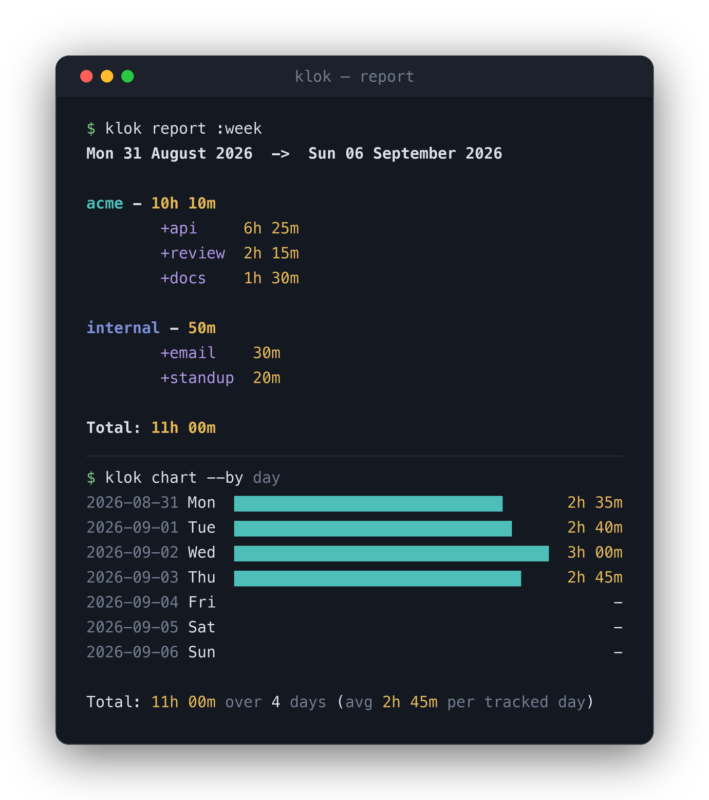

# klok

[](https://github.com/technomad641/klok/actions/workflows/ci.yml)
[](https://pypi.org/project/klok-cli/)
[](https://pypi.org/project/klok-cli/)
[](LICENSE)

**A command-line time tracker with a plaintext backend and zero dependencies —
that tracks not just where your time went, but how it felt.**

<p align="center">
  
</p>

klok brings together the features people actually use from Timetrap, Timewarrior,
Watson, utt, Bartib and friends — tags, timesheets, interval surgery, pomodoro,
exports — and adds a mindful side most trackers don't have: guided breathing,
sitting timers, and mood check-ins. It stores everything in one hand-editable
JSONL file and depends on nothing but the Python standard library.

## Highlights

- **Zero runtime dependencies.** Pure standard library, Python 3.9+. Nothing to
  audit, nothing to break.
- **One plaintext file is the whole database.** `frames.jsonl` diffs cleanly in
  git, syncs with any file tool, and can be edited by hand.
- **A CLI built for humans.** ~70 commands behind grouped help, "did you mean?"
  typo suggestions, and time parsing that takes `9am`, `-15m`, `since monday` or
  `2 hours ago`.
- **Correct under pressure.** Atomic writes, cross-platform advisory file
  locking, and 100 levels of `undo`.
- **Tested and portable.** 170 tests; CI runs the full suite on Linux, macOS and
  Windows across Python 3.9–3.13.
- **A point of view.** Mood/energy/stress check-ins, breathing and meditation
  are first-class — because how time felt is worth as much as where it went.

## Quick start

```sh
pip install klok-cli        # or: pipx install klok-cli
```

```sh
klok start acme +api -n "auth endpoint"   # begin, with a project, a tag, a note
klok status                               # what's running right now
klok stop                                 # stop the clock
klok report :week                         # where the week went
klok breathe                              # sixty seconds, box breathing
```

The package is `klok-cli` on PyPI; the installed command is plain `klok`. It also
runs straight from a checkout: `PYTHONPATH=. python3 -m klok status`.

## What it does

A curated taste — see the **[full reference](docs/reference.md)** for every
command, or run `klok --help`.

**Track time the way you work.** Start and stop with projects and `+tags`, record
intervals after the fact, or fix them later — `move`, `split`, `join`, `fill`,
and `undo` are all there.

```sh
klok track 09:00 to 11:30 acme +api   # log a finished interval
klok add internal +email              # name what you just did, after the fact
klok edit @1 --set-project acme       # @1 is the newest entry
```

**See where it went.** Summaries, per-project/tag breakdowns, bar charts, a
weekday × hour punchcard, and gap-finding.

<p align="center">
  
</p>

```sh
klok report :month --entries    # totals per project, broken down by tag
klok chart :month --by day      # a bar chart per calendar day
klok export :month -f csv       # also: ical, ledger, timeclock, md, json, tsv
```

**Keep contexts apart.** Separate timesheets keep a client's hours out of your
own, and focus timers double as trackers.

```sh
klok sheet client-x                  # switch timesheets
klok pomodoro acme +deep --rounds 4  # recorded as real entries
```

## The mindful side

Practice is tracked like everything else, but on its own sheet — so a month of
sitting never lands in a client's invoice. Guided breathing follows named
patterns (box, 4-7-8, coherent), meditation rings bells on a schedule, and
check-ins capture mood, energy and stress on a 1–5 scale.

<p align="center">
  
</p>

```sh
klok breathe 4-7-8            # a named pattern, or custom counts
klok meditate 20m --interval-bell 5m
klok checkin --mood 4 --energy 3 --stress 2
klok mindful :month          # sessions, time, averages, streaks
```

## A web dashboard (prototype)

Because the backend is just `frames.jsonl` and `checkins.jsonl`, it's easy to put
a richer surface on top. **Hours & Feelings** reads both streams and shows not
only where time went but how it felt — joining each check-in to whatever you were
tracking at that moment. It has an energy–time map (every project placed by hours
and energy), a deep-work streak, a mood calendar, trend lines, and a box-breathing
pause built on the same patterns as `klok breathe`.

A self-contained HTML prototype with demo data — open it in a browser:
**[`docs/dashboard/hours-and-feelings.html`](docs/dashboard/hours-and-feelings.html)**.
It's a design prototype; the natural next step is a `klok serve` command on the
standard-library HTTP server, keeping the no-dependency promise.

## How it's built

A flat package in `klok/`, layered cleanly: a small dataclass model (`Frame`), a
lock-protected plaintext store with atomic writes and undo, pure helper modules
for time parsing / exports / reporting, and one command layer that wires them
together. The whole data model is a single record type; everything else —
reports, exports, interval surgery, focus timers, mood — operates on it.

- **Testable by design.** Timers take injected clocks, so the suite never
  actually sleeps; commands run end-to-end in-process against a temp home.
- **Tolerant input, strict output.** The loader accepts hand-edited files and
  imports from other trackers; writes are atomic and locked.
- **Shipped properly.** PyPI releases go out via GitHub Actions with Trusted
  Publishing (OIDC) — no stored tokens.

## Data format

Everything lives in one directory (`$KLOK_HOME`, else `$XDG_DATA_HOME/klok`, else
`~/.local/share/klok`). `frames.jsonl` is the database — one JSON object per line:

```json
{"id": "7d2d3734", "start": "2026-08-31T09:00:00+02:00", "stop": "2026-08-31T10:30:00+02:00", "project": "acme", "tags": ["api"], "note": "auth endpoint", "sheet": "default"}
```

## Tests

```sh
cd klok && PYTHONPATH=. python3 -m unittest discover -s tests -t .
```

170 tests cover the time parser, the store (undo, locking, overlaps, gaps), the
breathing and sitting timers, the exporters, and every command end to end.

## Scope

klok records what you tell it and what its own timers observe — no screen-time
capture, no sync server (a synced `frames.jsonl` covers that ground), and no
health claims: the breathing patterns and bells are a pacer, not advice.

## Licence

MIT. See [LICENSE](LICENSE).
