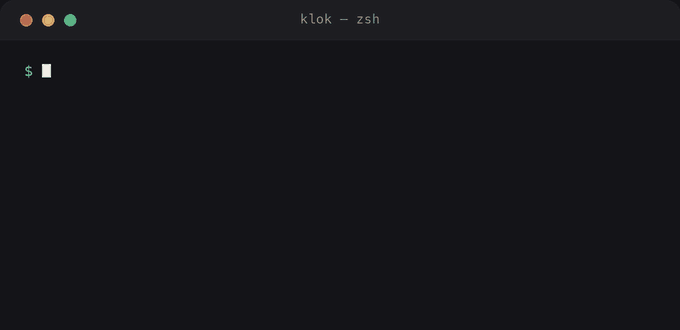
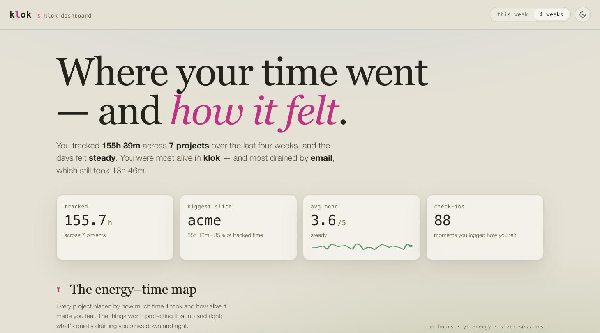
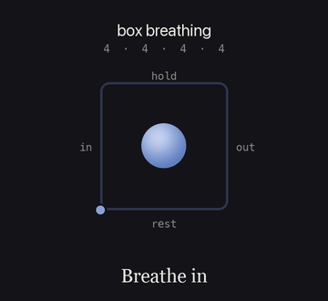

<div align="center">

# klok

### Track where your time went — and how it felt.

A zero-dependency command-line time tracker with a plaintext backend, an
energy digest that tells you which work drains you and which lifts you, and
a dashboard worth opening.

[](https://github.com/technomad641/klok/actions/workflows/ci.yml)
[](https://pypi.org/project/klok-cli/)
[](https://pypi.org/project/klok-cli/)
[](pyproject.toml)
[](LICENSE)

**[Install](#install)** · **[Live dashboard ▶](https://htmlpreview.github.io/?https://github.com/technomad641/klok/blob/main/docs/dashboard/hours-and-feelings.html)** · **[Highlights](#highlights)** · **[Reference](docs/reference.md)**

<br>



</div>

## Install

```sh
pip install klok-cli        # or: pipx install klok-cli
```

```sh
klok start acme +api -n "auth endpoint"   # begin: a project, a tag, a note
klok status                               # what's running right now
klok stop --felt 4                        # stop, and rate the energy 1–5
klok report :week                         # where the week went
```

The package is `klok-cli` on PyPI; the installed command is plain `klok`. Zero
dependencies, Python 3.9+. It also runs straight from a checkout:
`PYTHONPATH=. python3 -m klok status`.

## Highlights

|  |  |
|---|---|
| 🔋 **Energy-aware** | Joins *how you felt* to *what you did*, then tells you what drains you and what lifts you. No other tracker does this. |
| 🪶 **Zero dependencies** | Pure standard library. Nothing to audit, nothing to break, installs in a blink. |
| 📄 **One plaintext file** | `frames.jsonl` diffs cleanly in git, syncs with any file tool, and edits by hand. |
| 🎨 **A dashboard worth opening** | A single offline HTML file — no server, nothing fetched, no new deps. |
| ⚡ **Built for humans** | ~70 commands, "did you mean?" suggestions, and time parsing that takes `9am`, `-15m` or `since monday`. |
| 🛡️ **Correct under pressure** | Atomic writes, cross-platform file locking, 100 levels of `undo`, 222 tests on Linux/macOS/Windows. |

## What drains you, what lifts you

The thing no other tracker does: klok joins *how you felt* to *what you were
doing*. Rate a day's blocks in about twenty seconds, then let klok tell you
which work costs energy and which gives it back — from your own private, local
data. No cloud, no screen surveillance.

```sh
klok review                  # walk today's blocks, rate each 1–5 (a digit, then Enter)
klok stop --felt 4           # or rate a block the moment you stop it
klok digest :week            # what drained vs lifted you, in plain language
```

```text
+reviews drains you
  averages 1.3 points below your overall energy over 7 blocks
deep work lifts you
  averages 0.9 points above your overall energy over 11 blocks

Based on 34 rated blocks across 12 days. Rate more with `klok review` for sharper results.
```

`digest` only speaks once there's enough rated data to trust it, and the footer
always says how many blocks it's working from. No hand-waving.

## The dashboard

<div align="center">

<a href="https://htmlpreview.github.io/?https://github.com/technomad641/klok/blob/main/docs/dashboard/hours-and-feelings.html">
  
</a>

**[▶ Open the live dashboard](https://htmlpreview.github.io/?https://github.com/technomad641/klok/blob/main/docs/dashboard/hours-and-feelings.html)** — real demo data, runs entirely in your browser.

</div>

```sh
klok dashboard               # the last six weeks, opened in your browser
klok dashboard --demo        # try it with sample data first
```

**Hours & Feelings** reads `frames.jsonl` and `checkins.jsonl` and shows not
just where time went but how it felt: an energy–time map that floats your
energizing work up and to the right, a deep-work streak, a mood calendar, trend
lines, and a box-breathing pause. It's one self-contained HTML file written to
your data directory — no server, nothing fetched.

## In the terminal

<table>
<tr>
<td width="50%"></td>
<td width="50%"></td>
</tr>
<tr>
<td align="center"><code>klok report :week</code> · <code>klok chart --by day</code></td>
<td align="center"><code>klok timer 15m</code> · <code>klok breathe --list</code></td>
</tr>
</table>

**Track time the way you work.** Start and stop with projects and `+tags`,
record intervals after the fact, or fix them later with `move`, `split`,
`join`, `fill`, and `undo`.

```sh
klok track 09:00 to 11:30 acme +api   # log a finished interval
klok edit @1 --set-project acme       # @1 is the newest entry
klok export :month -f csv             # also: ical, ledger, timeclock, md, json, tsv
```

**Keep contexts apart.** Separate timesheets keep a client's hours out of your
own; focus timers double as real trackers.

```sh
klok sheet client-x                   # switch timesheets
klok pomodoro acme +deep --rounds 4   # recorded as real entries
```

## The mindful side



Practice is tracked like everything else, but on its own sheet — so a month of
sitting never lands in a client's invoice. Guided breathing follows named
patterns (box, 4-7-8, coherent), meditation rings bells on a schedule, and
check-ins capture mood, energy and stress on a 1–5 scale.

```sh
klok breathe 4-7-8
klok meditate 20m --interval-bell 5m
klok checkin --mood 4 --energy 3 --stress 2
klok mindful :month          # sessions, time, averages, streaks
```

<br clear="all">

## Why it's built this way

- **Zero runtime dependencies.** Pure stdlib, Python 3.9+. The whole thing is
  auditable in an afternoon.
- **Your data is yours, in plaintext.** One JSONL file under
  `$KLOK_HOME` (else `$XDG_DATA_HOME/klok`, else `~/.local/share/klok`). No
  cloud, no lock-in — a synced file covers multi-device.
- **Tolerant input, strict output.** The loader accepts hand-edited files and
  imports from other trackers; every write is atomic and locked.
- **Shipped properly.** PyPI releases go out via GitHub Actions with Trusted
  Publishing (OIDC) — no stored tokens.

```json
{"id": "7d2d3734", "start": "2026-08-31T09:00:00+02:00", "stop": "2026-08-31T10:30:00+02:00", "project": "acme", "tags": ["api"], "note": "auth endpoint", "sheet": "default"}
```

<details>
<summary><b>Run the tests</b></summary>

```sh
cd klok && PYTHONPATH=. python3 -m unittest discover -s tests -t .
```

222 tests cover the time parser, the store (undo, locking, overlaps, gaps), the
breathing and sitting timers, the exporters, the energy review/digest join, and
every command end to end. CI runs the full suite on Linux, macOS and Windows
across Python 3.9–3.13.

</details>

## Scope

klok records what you tell it and what its own timers observe — no screen-time
capture, no sync server, and no health claims: the breathing patterns and bells
are a pacer, not advice.

## Licence

MIT. See [LICENSE](LICENSE).
