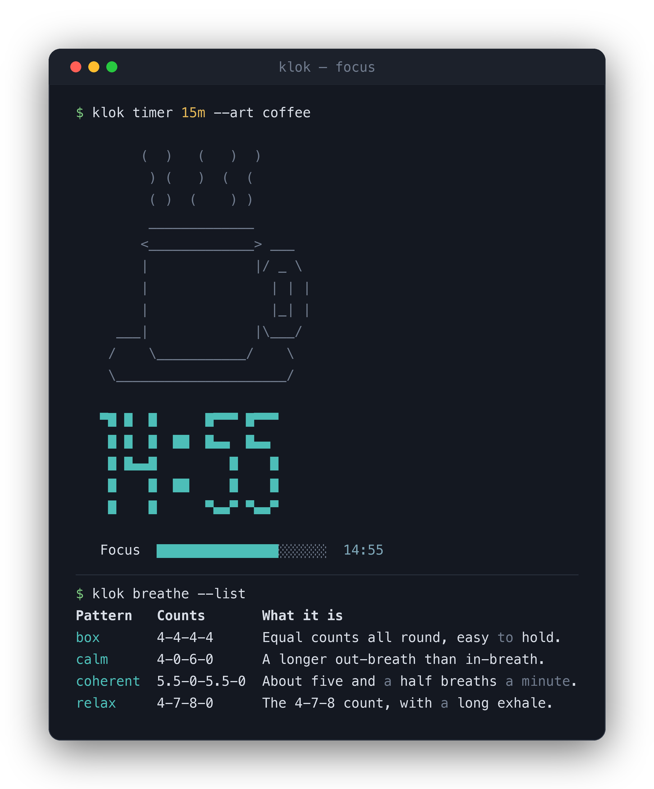

# klok — full reference

The [README](../README.md) covers the highlights. This is the complete reference:
every command, the full cross-tool feature map, configuration, and the data
format.

The fastest way in is `klok --help`. It opens with a five-line quick start, then
groups the ~70 commands and aliases (Tracking, Fixing entries, Reporting, Sheets
& config, Focus & mindfulness) so the shape of the tool is visible at a glance.
Each command's own `--help` has the full detail — `klok start --help`,
`klok breathe --help`, and so on.

```console
$ klok --help
Quick start:
  klok start acme +api       start tracking, tag it
  klok stop                  stop the clock
  klok status                what's running right now
  klok report :week          where the week went
  klok breathe               sixty seconds, box breathing

Tracking:
  start   Start tracking a project now (or at a given time).  (in, on)
  stop    Stop the running entry.  (out, off)
  ...
```

A typo gets a one-line correction instead of a wall of choices:

```console
$ klok statuss
klok: unknown command 'statuss' - did you mean 'status'?
Run `klok --help` for the full list.
```

And a fresh install says what to do next:

```console
$ klok status
Nothing tracked yet.
  Try `klok start acme +api` to begin, or `klok --help` for the full picture.
```

## Why these features

Each of the well-loved terminal time trackers is missing one thing the others
have. Timewarrior has the best interval surgery (`join`, `split`, `fill`,
`gaps`) but no pomodoro. Watson has the nicest project/tag model but no
timesheets. Timetrap has sheets and a pile of export formats but no tags. utt
has the "log it after the fact" flow nobody else does. Helm and arttime are
lovely timers that record nothing.

klok takes the useful parts of each and keeps a single, boring data file.

### Feature map

| From | Feature | In klok |
| --- | --- | --- |
| **Timetrap** | `t in` / `t out` | `klok in` / `klok out` (aliases of `start`/`stop`) |
| | Timesheets you switch between | `klok sheet NAME`, `klok sheets`, `klok sheet -` |
| | `t archive` | `klok archive :lastmonth` |
| | Retroactive `--at` | `klok start --at 9am`, `klok stop --at -15m` |
| | Formatters (csv, ical, json, ledger) | `klok export -f csv\|ical\|json\|ledger\|timeclock\|md\|tsv` |
| | Rounding | `--round 15`, or `general.round` in config |
| **Timewarrior** | `start` / `stop` / `continue` | `klok start` / `stop` / `continue` |
| | Tags on intervals | `klok start acme +api +urgent`, `klok tag ID +x -y` |
| | `annotate` | `klok annotate ID "text"` |
| | `summary` with daily subtotals | `klok summary :week` |
| | Range hints (`:week`, `:lastmonth`) | same hints, plus `last 7 days`, `since monday` |
| | `join` / `split` / `lengthen` / `shorten` / `move` / `fill` | all present, same names |
| | `gaps` | `klok gaps :day --min 15m` |
| | Exclusions (working hours, days off) | `exclusions.hours`, `exclusions.days`, `exclusions.holidays` |
| | `undo` | `klok undo` (100 levels deep) |
| | Charts | `klok chart --by day\|project\|tag\|sheet\|punchcard` |
| **Watson** | `project +tag` model | same |
| | `status`, `cancel`, `restart`, `log`, `report` | same names |
| | `rename project\|tag OLD NEW` | `klok rename` (also renames sheets) |
| | `projects`, `tags` listings | `klok projects`, `klok tags` (with totals) |
| | `edit` in `$EDITOR` | `klok edit` — or change fields inline with flags |
| | `aggregate` daily totals | `klok chart --by day`, `klok stats` |
| **utt** | Name the activity *after* doing it | `klok add acme +api` closes the open stretch |
| | `utt stretch` | `klok stretch` |
| | Break activities | tag them and filter with `-T break` |
| **Bartib** | Plaintext, hand-editable backend | JSONL, one entry per line |
| | `continue`, `last`, `change` | `klok continue`, `klok log --limit`, `klok switch` |
| | `sanity` check | `klok check` (overlaps, negatives, runaway timers) |
| **Helm / arttime** | Minimal countdown timer | `klok timer 25m --big --art coffee` |
| | Desktop notification + bell | automatic; `focus.notify`, `focus.bell` |
| **Focusd** | Focus sessions | `klok pomodoro acme +deep --rounds 4` — recorded as real entries |
| **feeling** | Mood tracking over time | `klok checkin --mood 4 --energy 3`, `klok mood :month` |
| *(new)* | Guided breathing | `klok breathe box`, `klok breathe 4-7-8 --for 5m` |
| *(new)* | Timed sitting with bells | `klok meditate 20m --interval-bell 5m` |
| *(new)* | Practice streaks | `klok mindful :month` |

## Commands

### Tracking

```sh
klok start acme +api -n "auth endpoint"   # aliases: in, on
klok start acme --at 9am                  # retroactive start
klok stop --at -15m                       # stopped a quarter hour ago
klok cancel                               # discard the running entry
klok status                               # aliases: now, current
klok switch internal +meeting             # stop and start at one instant
klok continue                             # same project and tags as last time
klok track 09:00 to 11:30 acme +api       # record a finished interval
klok track --from 09:00 -d 45m acme       # ...or give a length
klok add internal +email                  # close the gap since the last entry
klok stretch                              # pull an entry back to the previous one
```

`start` stops whatever was running (set `general.autostop = false`, or pass
`--no-stop`, to make that an error instead).

### Fixing what you recorded

Entries are addressed by id prefix (`7d2d`), by position (`@1` is the newest,
`@2` the one before), or by `@` for "the running one, or the last one".

```sh
klok annotate @1 "sprint planning"
klok tag @1 +urgent -meeting          # + adds, - removes
klok edit @1 --set-project acme --tags api docs
klok edit @1                          # opens $EDITOR with the entry as JSON
klok edit --range :day                # edit a whole day at once
klok move @1 08:00                    # keep the length, change the start
klok lengthen @1 30m / klok shorten @1 15m
klok fill @1                          # grow until it touches its neighbours
klok split @1 --at 10:15 / --into 3
klok join 7d2d e57b                   # merge entries, union their tags
klok delete @1 @2
klok undo                             # every change is undoable
```

### Reporting

<p align="center">
  
</p>

```sh
klok log :week                        # entries day by day (aliases: display, list)
klok summary :day                     # dense table with daily subtotals
klok report :month --entries          # totals per project, broken down by tag
klok chart :month --by day            # bar chart per calendar day
klok chart :month --by punchcard      # weekday x hour heat map
klok gaps :day --min 15m              # untracked stretches
klok stats :month                     # totals, streak, busiest day
klok projects / klok tags             # with totals
klok dashboard :month                 # Hours & Feelings web page (alias: dash)
```

`klok dashboard` writes a self-contained `dashboard.html` to the data directory
and opens it. It covers every sheet unless you pass `--sheet NAME`, and defaults
to the last 42 days. `-o FILE` writes it somewhere else, `--no-open` skips the
browser, and `--demo` shows the page with built-in sample data. Each check-in is
joined to the frame that was running when you logged it. Deep work means sessions
tagged with one of `dashboard.deep_tags` (default `deep,focus`) that run at least
`dashboard.deep_min` (25m); a day joins the streak at `dashboard.deep_goal` (90m).
If none of your frames carry those tags, every non-practice session long enough
counts.

Every report takes the same filters:

```sh
-p, --project NAME     repeatable; matches exactly, as a parent (acme matches acme.api), or as a glob
-t, --tag TAG          repeatable; all listed tags must be present
-T, --exclude-tag TAG  repeatable
    --contains TEXT    substring of project, tags or note
    --sheet NAME       a specific sheet
    --all-sheets       every sheet
-f, --format FMT       text (default), json, csv, tsv, ical, ledger, timeclock, md
```

### Time syntax

Anywhere klok takes a time: `now`, `noon`, `midnight`, `today`, `yesterday`,
`monday`, `last friday`, `9am`, `9:30pm`, `09:30`, `-15m`, `+1h30m`,
`2 hours ago`, `2026-08-31`, `2026-08-31 09:00`, `2026-08-31T09:00:00`, or a
unix timestamp.

Durations: `90` (minutes), `45s`, `25m`, `1h30m`, `1:30`, `2 hours`, `1w`.

Ranges: `:day` `:yesterday` `:week` `:lastweek` `:month` `:lastmonth`
`:quarter` `:year` `:lastyear` `:7d` `:30d` `:all`, plus `last 7 days`,
`since monday`, `2026-08-01 to 2026-08-31`, or a bare date for that one day.
`--from` / `--to` work too.

### Sheets

Separate timesheets, as in Timetrap — useful for keeping a client's hours apart
from your own.

```sh
klok sheet client-x        # switch
klok sheet                 # print the active one
klok sheet -               # back to the previous one
klok sheets                # list, with totals
klok archive :lastmonth    # move entries to _default so they leave reports
```

### Focus timers

<p align="center">
  
</p>

```sh
klok timer 25m -m "Deep work" --big --art coffee
klok timer 10m -p acme -t review          # also records the time
klok pomodoro acme +deep --rounds 4       # 4 x 25m work with breaks
klok pomodoro --work 50m --break 10m --no-prompt
```

Work rounds longer than a minute are recorded as ordinary entries, so they show
up in `report` alongside everything else. Notifications go through
`notify-send`, `terminal-notifier` or `osascript` when one is available, and
always ring the terminal bell.

### Mindfulness and meditation

Practice is tracked like everything else — but on its own sheet (`wellbeing`
by default), so a month of sitting never turns up in a client's invoice.

#### Breathing

```sh
klok breathe                       # the configured default, six rounds of box breathing
klok breathe 4-7-8                 # any counts: in-hold-out, or in-hold-out-hold
klok breathe calm --for 5m         # a named pattern, for a length instead of a round count
klok breathe --list                # what the named patterns are
klok breathe box --plan            # describe the session without running it
```

A pacer fills and empties a bar in time with the phase, naming each one and
counting it down. `Ctrl-C` stops it and still records what you did.

| Pattern | Counts | |
| --- | --- | --- |
| `box` | 4-4-4-4 | equal counts all round |
| `calm` | 4-0-6-0 | longer out-breath than in-breath |
| `coherent` | 5.5-0-5.5-0 | about five and a half breaths a minute |
| `relax` | 4-7-8-0 | the 4-7-8 count |
| `triangle` | 4-4-4-0 | no pause at the bottom |
| `even` | 5-0-5-0 | plain and symmetrical |

Custom counts work anywhere a name does: two counts are in and out
(`4-6`), three add the hold after the in-breath (`4-7-8`), four set every
phase (`5-2-7-2`).

#### Sitting

```sh
klok meditate                      # mindful.default_sit, ten minutes out of the box
klok meditate 20m --interval-bell 5m
klok meditate 30m --warmup 30s     # a settling bell before the sit proper
klok meditate 15m --no-guidance    # bells only, no prompts
klok meditate 20m --plan           # when the bells will land
```

A progress line, a bell at the end (and at each interval), and — unless you
turn them off — a few short prompts along the way. Sits are recorded as
`mindfulness +meditation`; breathing as `mindfulness +breathing`.

#### Check-ins

```sh
klok checkin --mood 4 --energy 3 --stress 2 after standup
klok checkin --mood 2 --at 09:15 -t monday
klok checkin                       # prompts for the three scales when run in a terminal
klok mood :month                   # the entries, plus a trend line per scale
klok mood --json
klok checkin --delete @            # or by id prefix
```

Three optional 1–5 scales (mood, energy, stress) and a free-text note. A bare
leading number is an energy shorthand, so `klok checkin 4` is `klok checkin
--energy 4`. `klok mood` renders each scale as a sparkline with its average,
and — once there are enough days to compare — notes how mood sat on your busier
days versus your lighter ones. That is an observation about two averages, not a
claim about cause.

#### Energy review and digest

```sh
klok review                        # walk today's blocks, rate each 1–5
klok review :week --all-sheets     # a wider range, every sheet
klok review --redo                 # re-walk and replace ratings already set
klok stop --felt 4                 # rate a block as you stop it
klok digest :week                  # what drained vs lifted you
klok digest :month -o energy.txt   # write a plain, shareable copy
```

`klok review` walks each tracked block in the range that has no energy rating yet
(active sheet by default; `--all-sheets` widens it) and asks for a single 1–5
rating per block: a digit then Enter records it, a blank line skips, `b` steps
back to re-rate the previous block, and `q` (or end-of-input) stops. Practice
sessions and a still-running frame are left out. Each rating is one energy
check-in stamped at the block's start, so the timestamp join ties it to that
block; re-rating (via `b` or `--redo`) replaces the rating rather than adding a
second one.

`klok digest` joins those ratings to their blocks and reports the projects and
tags whose mean energy sits at least half a point above or below your overall
average, over at least five rated blocks — ranked by effect size, most draining
first. Below that bar it stays quiet and says so; the footer always states how
many rated blocks and days it drew on, so the readout never claims more than the
data supports.

#### How the practice is going

```sh
klok mindful :month                # sessions, time, averages, streaks, last practice
klok mindful :year --no-chart
```

#### Break nudge

Once a single unbroken stretch of work passes `mindful.break_after` (90
minutes by default), `klok status` says so and suggests a minute of breathing.
Set the key to empty to switch it off.

## Configuration

```sh
klok config list
klok config set general.round 15
klok config set exclusions.hours 09:00-18:00
klok config edit
```

| Key | Default | Meaning |
| --- | --- | --- |
| `general.default_project` | – | project for a bare `klok start` |
| `general.week_start` | `monday` | drives `:week` and the week charts |
| `general.round` | `0` | round durations up to N minutes in reports |
| `general.time_format` | `24` | `24` or `12` hour clock |
| `general.autostop` | `true` | `start` stops what was running |
| `general.color` | `auto` | `auto`, `always`, `never` (`NO_COLOR` is honoured) |
| `general.editor` | `$VISUAL`/`$EDITOR` | editor for `klok edit` |
| `general.confirm_new_project` | `false` | refuse unknown projects without `--force` |
| `exclusions.hours` | – | e.g. `09:00-18:00`; `gaps` ignores time outside |
| `exclusions.days` | – | e.g. `saturday,sunday` |
| `exclusions.holidays` | – | comma-separated `YYYY-MM-DD` dates |
| `focus.work` / `focus.break` / `focus.long_break` / `focus.rounds` | `25m` / `5m` / `15m` / `4` | pomodoro defaults |
| `focus.notify` / `focus.bell` / `focus.track` | `true` | timer behaviour |
| `mindful.project` | `mindfulness` | project practice is recorded against |
| `mindful.sheet` | `wellbeing` | sheet practice is recorded on |
| `mindful.track` | `true` | record practice at all |
| `mindful.pattern` | `box` | default breathing pattern |
| `mindful.breath_rounds` | `6` | default number of breaths |
| `mindful.default_sit` | `10m` | default length of `klok meditate` |
| `mindful.interval_bell` | – | default interval bell during a sit |
| `mindful.warmup` | – | default settling bell |
| `mindful.guidance` | `true` | show prompts during a sit |
| `mindful.break_after` | `90m` | when `klok status` suggests a pause (empty = never) |
| `dashboard.deep_tags` | `deep,focus` | tags that mark deep work in `klok dashboard` |
| `dashboard.deep_min` | `25m` | shortest session that counts as deep work |
| `dashboard.deep_goal` | `90m` | deep work a day needs to join the streak |

## Where the data lives

```sh
klok where
```

Everything sits in one directory (`$KLOK_HOME`, else `$XDG_DATA_HOME/klok`,
else `~/.local/share/klok`):

```
frames.jsonl   one JSON object per line, sorted by start time
checkins.jsonl mood/energy/stress check-ins, same shape
dashboard.html the last page `klok dashboard` wrote
config.ini     configuration
state.json     which sheet is active
undo.d/        the last 100 states, one snapshot per file, for klok undo
```

`frames.jsonl` is the whole database. It diffs well in git, syncs with any file
sync tool, and can be hand-edited:

```json
{"id": "7d2d3734", "start": "2026-08-31T09:00:00+02:00", "stop": "2026-08-31T10:30:00+02:00", "project": "acme", "tags": ["api"], "note": "auth endpoint", "sheet": "default"}
```

Writes are atomic and take a lock file, so a `klok stop` from a shell hook
cannot interleave with one from your prompt. Every mutation snapshots the
previous file first — `klok undo` walks back through them.

## Exports

```sh
klok export :month -f csv -o august.csv
klok export :month -f ical > august.ics
klok export :month -f timeclock | hledger -f - balance   # ledger/hledger native
klok export :month -f md                                 # paste into an invoice
klok import august.json                                  # JSON, JSONL or CSV
```

## Shell completion

```sh
source <(klok completion bash)     # or zsh
klok completion fish > ~/.config/fish/completions/klok.fish
```
